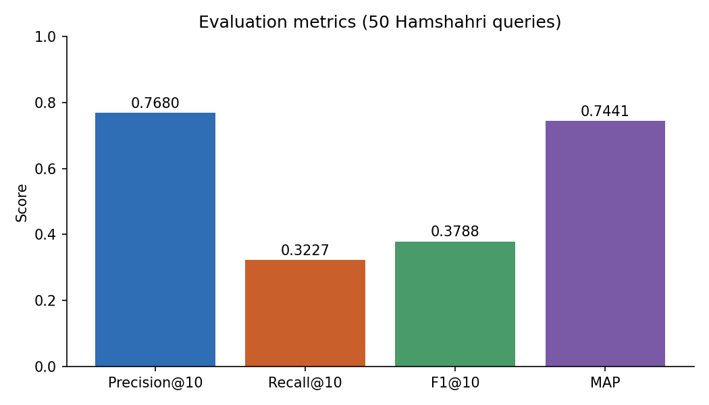
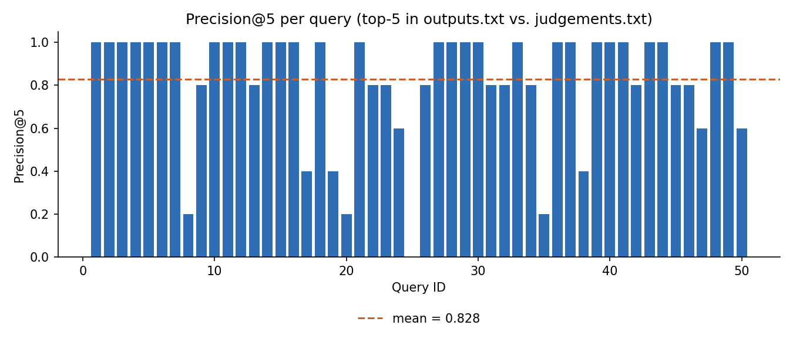

# Persian News Information Retrieval (TF-IDF) — Hamshahri Collection

A from-scratch **TF-IDF + cosine-similarity** retrieval system for Persian news articles, evaluated on queries and relevance judgements from the **Hamshahri** test collection.

> Author: <danial moradi>

## Overview

Given a Persian query, the system ranks news documents by cosine similarity between TF-IDF vectors and reports retrieval quality against human relevance judgements. The TF-IDF matrix, cosine similarity, ranking and evaluation metrics are implemented manually (only `hazm` and `numpy` are used).

## Pipeline (as implemented in the notebook)

1. **Preprocessing** – `hazm` normalization, removal of non-Persian characters, `hazm` word tokenization, stop-word removal (`persian_stopwords.txt`), tokens of length 1 dropped, `hazm` stemming.
2. **Indexing** – vocabulary, document frequency, `idf = log(N / (df + 1))`, TF-IDF with `tf = count / document length`.
3. **Retrieval** – the query goes through the same preprocessing; every document is scored with cosine similarity and all documents are ranked.
4. **Evaluation** – Precision@10, Recall@10, F1@10 and MAP over 50 queries.

## Results

Metrics printed by the notebook (see [`results/outputs.txt`](results/outputs.txt)):

| Metric | Value |
|---|---|
| Mean Precision@10 | 0.7680 |
| Mean Recall@10 | 0.3227 |
| Mean F1-score@10 | 0.3788 |
| MAP | 0.7441 |



Per-query Precision@5, computed from the top-5 results saved in `results/outputs.txt` and the relevance judgements (mean 0.828; query 25 has no relevant document in its top 5):



Recall@10 is naturally limited here: the judgements list about 45 relevant documents per query on average, so at most 10 of them can be retrieved in the top 10.

## Dataset

The Hamshahri corpus, queries and relevance judgements are **not included** in this repository. Obtain them from the official source (<LINK TO HAMSHAHRI COLLECTION — verify the license/terms>) and place them next to the notebook:

```
HamshahriData/
├── HamshahriCorpus/        # year folders (2003 … 2007) containing *.ham files
├── Queries/                # 1.q … 50.q
├── RelativeAssesemnt/
│   └── judgements.txt      # "<query_id> <doc_id>" per line
└── persian_stopwords.txt
```

## Setup and usage

Requires Python 3.10+ (the notebook was last run with 3.10.11).

```bash
python -m venv .venv
.venv\Scripts\activate          # Windows  (Linux/macOS: source .venv/bin/activate)
pip install -r requirements.txt
jupyter notebook DanialMoradi.ipynb   # rename to match your final file name
```

Run the single code cell. It loads the data, builds the index, prints the metrics and the top-5 results for every query.

## Limitations

- The TF-IDF matrix is stored as a dense NumPy array (documents × vocabulary), which can need a lot of RAM on larger collections.
- Scoring loops over all documents in pure Python, so queries are slow on large corpora.
- No inverted index, no BM25 or other weighting schemes were compared.

## Future improvements

- Sparse matrices (`scipy.sparse`) or an inverted index.
- Compare with BM25 and other TF-IDF variants.
- Query expansion and better Persian normalization.

## License and attribution

Code: <CHOOSE A LICENSE, e.g. MIT>. The Hamshahri collection belongs to its original authors and is subject to its own terms.
